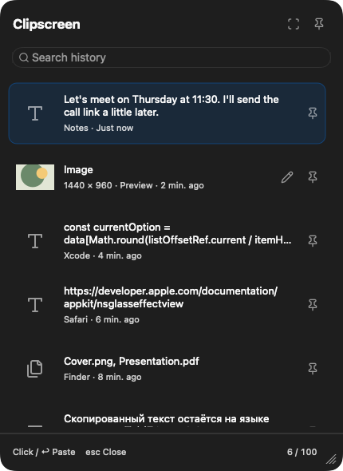
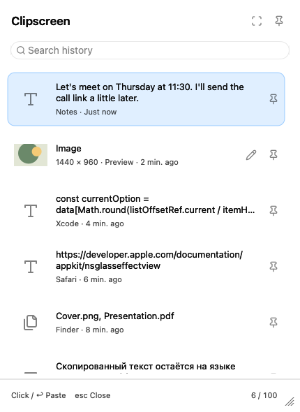

# Clipscreen

<p align="center">
  <strong>Lightweight native clipboard manager for macOS with Windows Win+V simplicity.</strong>
</p>

<p align="center">
  <a href="#readme"></a>
  <a href="#readme"></a>
  <a href="LICENSE"></a>
  <a href="#readme"></a>
</p>

<p align="center">
  English &bull; <a href="README.ru.md">Русский</a>
</p>

---

<p align="center">
  
  &nbsp;&nbsp;
  
</p>

## Overview

**Clipscreen** is a minimal, blazingly fast clipboard manager for macOS built with native Swift and AppKit. It lives unobtrusively in your menu bar without cluttering the Dock, keeping the last 100 clipboard entries readily available at your fingertips.

Press **⌥⌘V**, navigate with arrow keys or type to filter, and press **Enter** to paste directly into your active app.

## Why I built Clipscreen

I built Clipscreen after switching from Windows to Mac. One shortcut I kept missing was **Win+V**: open clipboard history and paste something I'd copied earlier. It was a small habit that I wanted to keep.

Clipscreen is my way of bringing that workflow to the Mac. Press **⌥⌘V**, pick an earlier item, and carry on with what you were doing.

— Kirill

## Features

- **Instant Recall & Paste**: Press `⌥⌘V` anywhere, select an item, and press `Return` to auto-paste back into the active application.
- **Rich Content Support**: Preserves plain text, rich formatted text (RTF), full-resolution images (with lightweight PNG thumbnails), and Finder file references.
- **Instant Search**: Filter through entries in real time by copied text or source application name.
- **Screenshot Button**: Integrated camera button (`⌥⌘4`) in the header launches interactive area selection and saves the screenshot directly into your clipboard history.
- **Consistent Icons**: Original Lucide SVGs across history, search, menu bar, and screenshot tools; bundled locally with their license.
- **Pinned Items**: Pin buttons stay at the far right. Use `⌘P` for the selected item or `⇧⌘P` to filter pinned items. Clear History keeps favorites; delete them individually when needed.
- **Text on Screenshots**: Click the Text button next to Color, then click the image to type. Choose from System, Serif, Monospaced, Rounded, Helvetica Neue, Avenir Next, Georgia and Menlo (when installed), with sizes from 12–96 pt. In Text mode, drag a label to move it or double-click to edit. Return adds a line, Command-Return applies, Escape cancels the edit. Text and style changes support Undo/Redo and full-resolution PNG export.
- **Blur Area**: Right-click the filled rectangle and choose **Blur Area**, then drag over the screenshot. The same menu on an existing rectangle switches between blur and solid fill, with Undo/Redo. Blur is included in the exported PNG and affects earlier annotations beneath it.
- **Screenshot Styling**: Right-click a tool or drawn annotation to choose stroke width. Outline and solid rectangles use matching square icons. Custom colors use a permanent rainbow-plus button; width edits support Undo/Redo.
- **Window Positioning**: Draggable floating panel that remembers its position across invocations.
- **Native Design**: Built with AppKit and modern macOS materials (Liquid Glass on macOS 26, standard system blur with Reduce Transparency fallback), respecting system Dark/Light themes.
- **Zero Bloat**: No Electron, no web runtime, zero external dependencies, minimal memory footprint.
- **Privacy & Security**: 100% offline. Sensitive data from password managers (1Password, Bitwarden, KeePass, `org.nspasteboard.ConcealedType`, `TransientType`, `AutoGeneratedType`) is automatically excluded.

## Keyboard Shortcuts

| Shortcut | Action |
| --- | --- |
| `⌥⌘V` | Open or dismiss the Clipscreen history panel |
| `↑` / `↓` | Navigate history items |
| `Tab` / `⇧Tab` | Move focus down / up across entries |
| `Return` | Paste selected entry into active application and close panel |
| `Space` | Select / preview item |
| `⌘⌫` | Delete selected entry from history |
| `⌥⌘4` / 📷 | Take an interactive screenshot directly to clipboard |
| `Esc` | Close panel without pasting |

## Requirements

- **Operating System**: macOS 13.0 (Ventura) or later (tested up to macOS 26 / Tahoe).
- **Architecture**: Apple Silicon (`arm64`) and Intel (`x86_64`).
- **Build Tools**: Xcode 26 or compatible Command Line Tools with the macOS 26 SDK (`swiftc`). The build SDK requirement is separate from the macOS 13 deployment target.

## Installation & Build

Clipscreen can be built locally in seconds without any package manager:

```bash
# 1. Clone the repository
git clone https://github.com/zolygin/clipscreen-macos.git
cd clipscreen-macos

# 2. Build the app bundle
bash scripts/build-app.sh

# 3. Launch Clipscreen
open .build/Clipscreen.app
```

> **Tip:** For daily use, move `Clipscreen.app` to `/Applications` before enabling login items or granting system permissions.

`Clipscreen.app` is the application itself; Terminal is not needed to launch it after installation. A DMG is a distribution container around that app. See [Building and distributing Clipscreen](docs/DISTRIBUTION.md) for local installation and the one-command signed/notarized release workflow.

### Signed distribution build

To produce a Universal 2 DMG for Apple Silicon and Intel, with Developer ID signing and Apple notarization:

```bash
npm run dist:check  # Local prerequisites only; no build/upload
npm run dist        # Compile, sign, package, notarize and verify
```

The output is `release/Clipscreen-0.5.0-universal.dmg`, with a checksum and release manifest. This wrapper requires Node.js 22+ and configured Apple signing/notarization credentials; no `npm install` is needed. It does not publish to GitHub. See [distribution setup](docs/DISTRIBUTION.md). Source/development builds above do not require a paid Developer ID identity.

### First Launch & Permissions

1. **Pasteboard Access**: When prompted by macOS, allow clipboard access so Clipscreen can monitor copied items in the background.
2. **Accessibility Permission (for 1-click paste)**: To allow Clipscreen to automatically paste items into your destination app upon pressing `Return`, enable Clipscreen in **System Settings → Privacy & Security → Accessibility**.
   *(If Accessibility is not granted, pressing Return will copy the item to the clipboard for manual `⌘V` pasting).*
3. **Launch at Login**: Right-click the Clipscreen icon in the macOS menu bar to enable "Launch at Login".

## Windows and build identity

Clipscreen runs in the menu bar. Escape dismisses history; in a screenshot editor, Escape, Command-W or the red close button closes that editor. With an editor active, the Window menu lists the open screenshot editors. Each editor retains its own drawing and controls until it closes. Choose **Quit Clipscreen** from the menu bar menu to quit the app and close all its windows.

After a capture, the ready screenshot editor is presented through a shared foreground/focus handoff for the shortcut and menu bar action. Pending focus requests are cancelled when the editor closes or another capture begins. Implementation and verification limits: [screenshot focus fix](docs/SCREENSHOT-FOCUS-FIX.md).

The menu bar menu shows the running version/build. Hover over that version to see the build date, source revision and app path. Quit an older copy before opening a new build: a second copy at another path now explains which copy is already running instead of silently exiting.

The development app is built at `.build/Clipscreen.app`. Version 0.3.0 retains the earlier `local.kirill.clip` development identity, preference keys and `Application Support/Clip` history directory for compatibility; renaming the product does not reset history or pinned items.

## Privacy & Data Storage

- **Local Storage Only**: All history is stored locally in `~/Library/Application Support/Clip/`. No server, no telemetry, no analytics, no network access.
- **Secure File Permissions**: The history directory is restricted to owner-only permissions (`0700`), and binary files are stored with `0600` permissions.
- **Password Manager Protection**: Clipboard entries marked with `org.nspasteboard.ConcealedType`, `TransientType`, `AutoGeneratedType`, or `com.agilebits.onepassword` are ignored and never written to disk.
- **Capacity**: Stores the 100 most recent items (max 50 MB per payload). Duplicates automatically move to the top without taking extra slots.

## Verification & Testing

The project includes an isolated test suite and headless UI preview renderer:

```bash
# Run 22 unit and integration tests (uses isolated temporary pasteboards)
bash scripts/check.sh

# Render and verify 65 native visual/export scenarios, pin alignment and 120 resize updates
bash scripts/check-ui.sh
```

The latest interface diagnosis, visual constraints, verification limits, and filled implementation QA checklist are in [the Lucide and resize review](docs/UI-UX-LUCIDE-REVIEW.md).

Expanded fonts and rectangle blur: [implementation and QA](docs/UI-UX-BLUR-FONTS-REVIEW.md).

Text annotations and the filled implementation QA checklist: [text tool review](docs/UI-UX-TEXT-REVIEW.md).

Screenshot editor behavior and the filled QA checklist: [stroke widths and custom color](docs/UI-UX-EDITOR-REVIEW.md).

## Contributing

Contributions, feature suggestions, and bug reports are welcome! Please check [CONTRIBUTING.md](CONTRIBUTING.md) for details.

## License

This project is licensed under the [MIT License](LICENSE).
